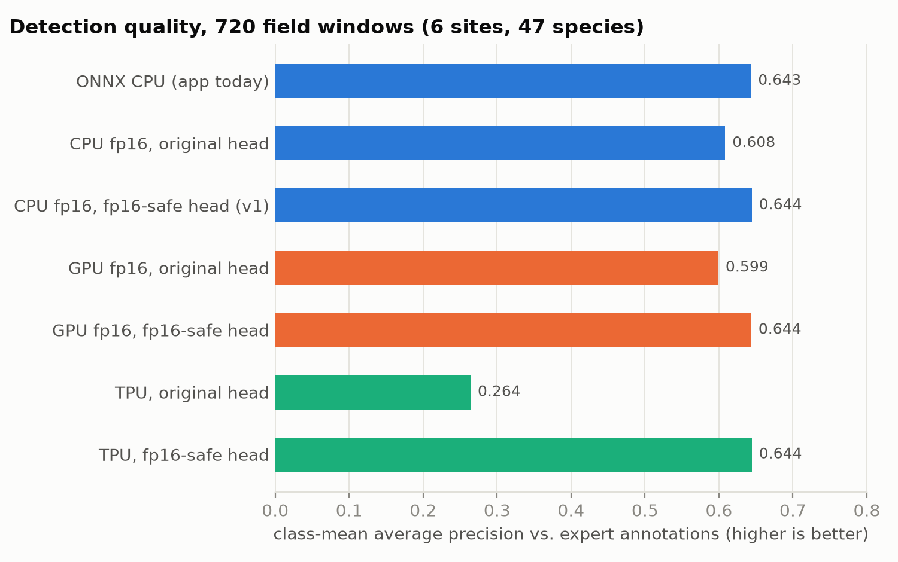
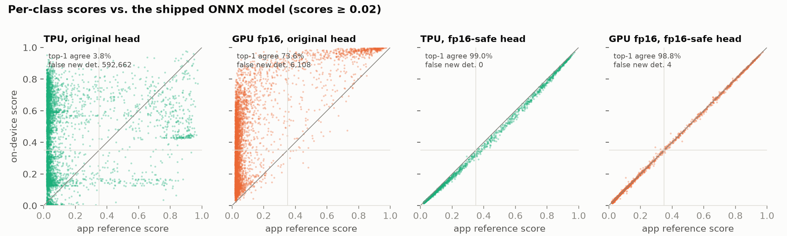
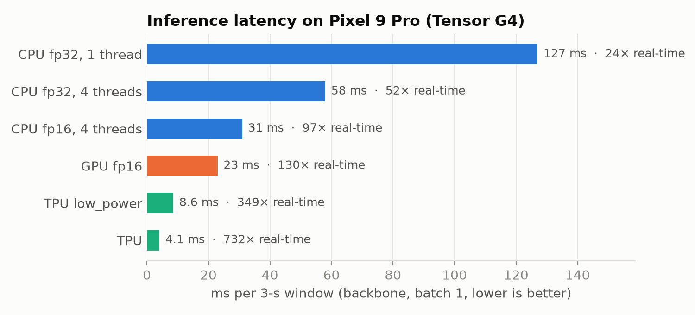
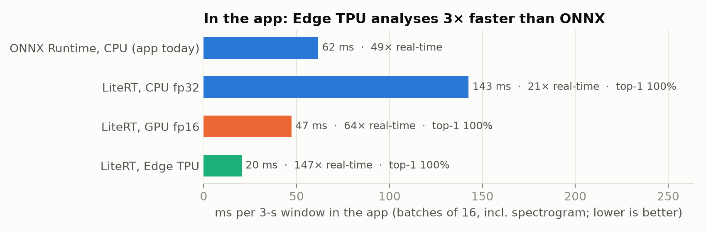
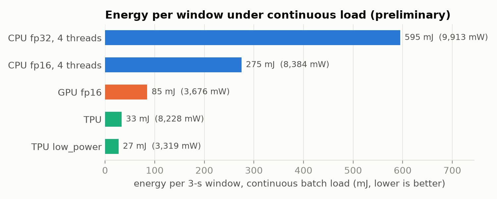
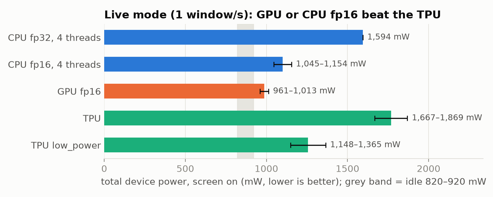

# BirdNET+ V3.0 on the Google Tensor Edge TPU (Pixel 9 Pro)

Research notes behind the experimental LiteRT backend in this branch
(`lib/features/inference/litert_classifier_model.dart`,
`android/app/src/main/kotlin/com/birdnet/birdnet_live/LiteRtChannel.kt`).
Follow-up to #76.

- Device: Pixel 9 Pro (Tensor G4), Android 17, connected over ADB Wi-Fi.
- Model: `BirdNET+_V3.0_Global_10K_FP16_BNL.onnx`, bit-identical to `assets/models/`.
- Runtime: LiteRT (TFLite) with the NNAPI delegate (`google-edgetpu`, fp16 allowed), the
  GPU delegate, or XNNPACK. Standalone numbers come from LiteRT's `benchmark_model`;
  in-app numbers from `integration_test/litert_backend_test.dart`.

## TL;DR

1. **The GeM pooling head breaks every fp16 path** (Edge TPU, GPU fp16, XNNPACK fp16):
   `x ** 6.6` underflows in fp16. The backbone is fp16-safe.
2. **An fp32-identical rewrite of the head fixes it** (section 1); Edge TPU and GPU then match
   ONNX on field recordings (section 2).
3. **The Edge TPU is 3× faster than ONNX in the app** (section 3). It is the most energy-efficient
   option for batch analysis, but not at one window per second (section 4). The app's *Auto*
   setting follows this split.
4. **#76 most likely never ran on the TPU:** without `allow_fp16`, NNAPI rejects the model and
   ONNX Runtime fell back to the CPU.

## 1. The fp16-safe GeM head

Original: `GeM(x) = mean(clamp(x, eps, 3.5) ** p) ** (1/p)` per channel over the 7×9 map,
p ≈ 6.64, eps ≈ 1e-6. Rewrite (`scripts/build_tail_logdomain.py`, `HEAD=v2`):

```
x  = clamp(x, eps, 3.5)
m  = max(max_hw(x), 2^-14)            # per channel; keeps the divisor a normal fp16 number
r  = clamp(x / m, 2^-14, 1)           # r ≤ 1, so r^p cannot overflow; log() never sees 0
g  = m · mean_hw(exp(p · log r)) ^ (1/p)   # = GeM(x): the max term contributes exactly 1
```

- Dividing by the per-channel maximum keeps every term in (0, 1] and the mean ≥ 1/63.
- `POW` becomes `exp(p · log r)`: the Edge TPU returns NaN for `POW` with a fractional exponent.
- Clamping `r` at 2^-14 only changes terms below (2^-14)^p ≈ 1e-28 of the max term.
- `reshape` instead of `m[:, 0, 0, :]`: a `STRIDED_SLICE` with `shrink_axis` is not
  supported by the GPU delegate and pushed 5 ops back to the CPU.
- A first version (v1) scaled `x` by 1024 instead of clamping `r`. It is fine on the TPU and
  on XNNPACK fp16, but the GPU delegate mis-computes it once fused with the backbone (top-1
  46 %), although backbone and head are each correct on the GPU on their own and even as a
  chain of two graphs (`scripts/gpu_fp16_probe.py`, output in `results/gpu_fp16_probe.txt`).

fp32 difference to the original head: max 3e-4 on the scores, cmAP unchanged (0.643).
The rewrite only touches the pooling head, so it applies to any fp16 build of the model
(ONNX fp16, LiteRT, Core ML), not just to LiteRT.

## 2. Accuracy on field recordings

720 windows of 3 s from six annotated soundscape collections on Zenodo (three random 2-min
excerpts per site: HSN, NES, PER, SNE, SSW, UHH; 481 windows with labels, 47 species).
Reference = the shipped ONNX model on the desktop CPU (`scripts/make_fieldset.py`,
`scripts/field_device.py`, `scripts/eval_field.py`; full table in
`results/field_metrics.csv`, per site in `results/field_site_ap.csv`).



| Variant on the Pixel | top-1 vs ONNX | detections ≥ 0.35 (ONNX: 607) | precision @ 0.35 | cmAP |
|---|---|---|---|---|
| ONNX Runtime CPU (reference) | – | 607 | 0.717 | 0.643 |
| Edge TPU, original head | 3.7 % | **593,136** | 0.001 | 0.264 |
| GPU fp16, original head | 73.6 % | 6,709 | 0.081 | 0.599 |
| CPU fp16 (XNNPACK), original head | 73.9 % | 6,278 | 0.086 | 0.608 |
| GPU fp16, head v1 (×1024) | 46.0 % | 240 | 0.671 | 0.536 |
| **Edge TPU, head v2** | **99.0 %** | 582 (all also in ONNX) | 0.730 | **0.644** |
| **GPU fp16, head v2** | **98.8 %** | 609 (605 also in ONNX) | 0.716 | **0.644** |



The remaining differences with head v2 are the normal fp16 effect: borderline scores just
below or above 0.35 (mean |Δ| 0.005–0.019). Per site the cmAP of TPU and GPU stays within
±0.002 of ONNX.

## 3. Speed

Classifier only (`benchmark_model`, batch 1, 3-s window):



In the app (`integration_test/litert_backend_test.dart`, 64 real windows, debug build;
`results/app_integration_test.md`):



| Backend | ms / window (batches of 16) | × real time | split: spectrogram / classifier / channel | top-1 vs ONNX |
|---|---|---|---|---|
| ONNX Runtime, CPU (today) | 61.6 | 49× | – | – |
| **LiteRT, Edge TPU** | **20.4** | **147×** | 9.7 / 5.4 / 4.1 ms | 100 % |
| LiteRT, GPU fp16 | 47.2 | 64× | 12.9 / 30.5 / 4.3 ms | 100 % |
| LiteRT, CPU fp32 | 142.5 | 21× | 5.5 / 132.9 / 4.8 ms | 100 % |

With the TPU, the classifier is no longer the bottleneck. The spectrogram frontend runs on one
CPU thread (4 threads are 5× slower: 12 tiny partitions, sync overhead dominates); neither the
GPU nor the TPU delegate accepts it. Not tried yet: overlapping frontend and classifier in batch
mode, and a release build (all in-app numbers are from a debug build). LiteRT on the CPU is
slower than ONNX Runtime and is only a fallback.

The first TPU load compiles the model (≈ 6–8 s in the app). The backend caches the compiled
program in `codeCacheDir` (cleared on app updates); with that cache `benchmark_model` loads in
≈ 0.5 s. The cache hit inside the app is not verified yet, because `flutter test` reinstalls the app.

## 4. Power

Classifier only, battery current × voltage via sysfs (`scripts/power.sh`, no root), screen on,
idle ≈ 820–920 mW.




| | CPU fp32 4T | CPU fp16 4T | GPU fp16 | Edge TPU | TPU `low_power` |
|---|---|---|---|---|---|
| continuous load: energy / window | 595 mJ | 275 mJ | 85 mJ | **33 mJ** | **27 mJ** |
| 1 window / s: total power | 1,594 mW | 1,045–1,154 mW | **961–1,013 mW** | 1,667–1,869 mW | 1,148–1,365 mW |

## 5. Platform notes

- **NNAPI** is deprecated since Android 15 but is the **only** route to the Edge TPU on Tensor
  G4. LiteRT's new `CompiledModel` + `Accelerator.NPU` path needs AOT compilation with the
  Google Tensor SDK, which supports Tensor G5/G6 only. LiteRT 2.x removed `NnApiDelegate`, so
  the app pins `com.google.ai.edge.litert:litert:1.4.2`.
- `flutter_litert` cannot select an NNAPI accelerator or allow fp16, so the backend talks to
  LiteRT's Java API through a method channel instead.
- **Model size:** the classifier `.tflite` is 132 MB (fp32 weights). A variant with fp16
  weights (66 MB) runs on the GPU but the NNAPI/TPU compilation rejects it. No smaller
  TPU-compatible graph was found.
- Fixed shapes: the LiteRT graphs take 3-s windows only; 5 and 10 s stay on ONNX.
- `onnx2tf` cannot convert the ONNX frontend (Gather/Resize); `scripts/build_frontend_tf.py`
  rebuilds it in TensorFlow (max |Δ| 4e-5).

## Reproduce

Python 3.11 with `onnx onnxruntime onnxsim numpy soundfile scipy pandas pyarrow scikit-learn
matplotlib tensorflow-cpu tf-keras onnx2tf onnx-graphsurgeon sng4onnx ai-edge-litert`, run from
this directory:

```sh
SRC=../../assets/models/BirdNET+_V3.0_Global_10K_FP16_BNL.onnx
python scripts/make_fp32_static.py "$SRC" models/v3_fp32_3s.onnx 96000   # fixed [1, 96000], fp32
python scripts/split.py models/v3_fp32_3s.onnx                          # frontend | backbone
python scripts/split_trunk.py                                           # trunk | GeM head at silu_101
onnx2tf -i models/v3_trunk_3s.onnx -o models/tf_trunk -n \
    -cind node_div_1_output_cast_0 models/cind.npy "[[[[0]]]]" "[[[[1]]]]"
python scripts/build_frontend_tf.py                                     # -> models/frontend_3s.tflite
HEAD=v2 OUT=models/v3_litert_v2_3s.tflite PYTHONPATH=scripts python scripts/build_tpu_model.py
FROM="serving_default_spec:0" python scripts/fixname.py models/v3_litert_v2_3s.tflite
```

`models/cind.npy` holds 20 calibration spectrograms (`scripts/make_specs.py`); onnx2tf also
needs `calibration_image_sample_data_20x128x128x3_float32.npy` in the working directory.

Field evaluation (needs the Zenodo soundscapes; `DATA_ROOT` points at the data layout used here):

```sh
python scripts/make_fieldset.py "$SRC"           # -> models/field/{specs,audio,labels,ref_onnx}.npy
python scripts/field_device.py push
python scripts/field_device.py run tpu_v2 gpu16_v2 tpu_orig gpu16_orig cpu16_orig
python scripts/eval_field.py && python scripts/plots.py
```

`field_device.py` drives LiteRT's `benchmark_model` (nightly
`android_aarch64_benchmark_model`) at `/data/local/tmp/bn/bm`, one call per window.
In-app test: `python scripts/export_windows.py windows.f32 64`, push it to the app's external
files dir, then `flutter test integration_test/litert_backend_test.dart -d <device>`.

| Script | Purpose |
|---|---|
| `make_fp32_static.py`, `split.py`, `split_trunk.py` | ONNX → fp32, fixed shape; split frontend / trunk / head |
| `build_frontend_tf.py`, `front.py` | Frontend rebuilt in TensorFlow |
| `build_tail_logdomain.py`, `build_tpu_model.py`, `fixname.py` | fp16-safe head, trunk + head → one `.tflite` |
| `act_ranges.py`, `inspect_onnx.py` | Activation ranges for the fp16 check, graph inspection |
| `parity.py`, `trunk_parity.py`, `full_parity.py`, `tail_tpu_parity.py`, `device_parity.py`, `devrun.py` | Parity checks on host and device (soundscape example) |
| `make_specs.py`, `make_fieldset.py`, `field_device.py`, `eval_field.py` | Field test set, device runs, metrics |
| `gpu_fp16_probe.py` | Localises fp16 errors: fused vs. split vs. chained graphs on GPU/TPU |
| `power.sh`, `power_repeat.sh` | Power measurement on the device (round 1, repeats); logs in `results/power/` |
| `plots.py`, `export_windows.py` | Figures; audio windows for the in-app test |

`results/` also holds the onnx2tf conversion logs and the raw in-app test output
(`results/logs/`; run 2 is before, run 4 after the single-thread frontend fix). The per-window
device predictions (`models/field/pred_*.npy`, ~30 MB each) are not committed; rerun
`field_device.py` to regenerate them.
